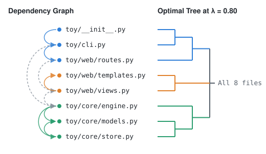
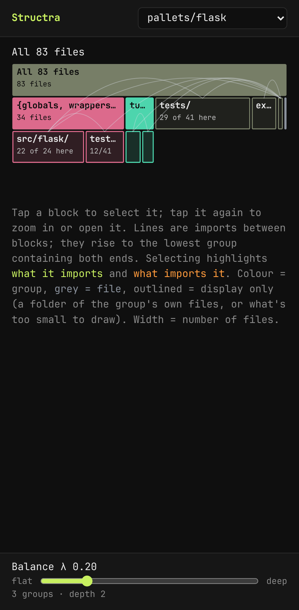
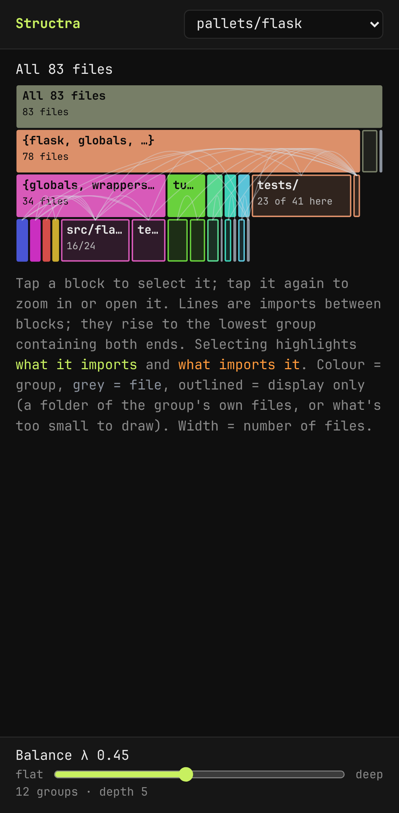
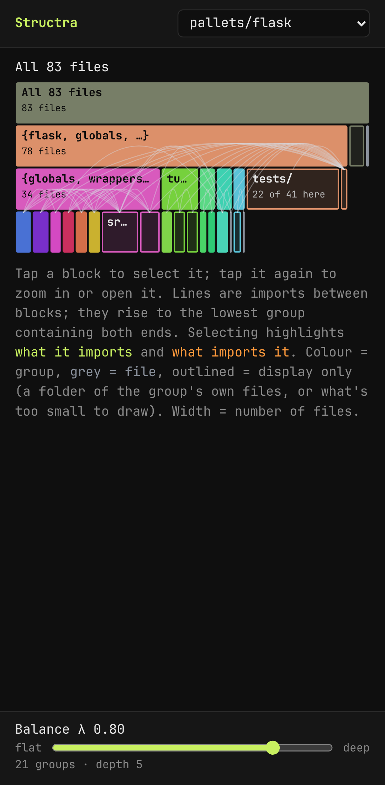

# Structra

**See the structure your imports imply.**

Structra reads the file-to-file imports of a repository (its **Dependency Graph**) and finds the hierarchy that keeps imports inside their groups: the **Optimal Tree**. It ignores your folders entirely, so you can hold the result up against them yourself.

<p align="center">
  
</p>

Eight files of a toy package ([`examples/toy.graph.json`](examples/toy.graph.json)), drawn by Structra's own optimizer (`npm run readme:diagram`). Solid arcs are imports inside one group, dashed arcs cross between groups. `web/routes.py` lands next to `cli.py`, not with the other `web/` files: that is where its imports put it.

## Live demo

**[realjohndoe.github.io/structra](https://realjohndoe.github.io/structra/)** opens on flask. It works on a phone. Drag the **Balance λ** slider to watch the tree change.

<table>
  <tr>
    <td align="center" width="33%"></td>
    <td align="center" width="33%"></td>
    <td align="center" width="33%"></td>
  </tr>
  <tr>
    <td align="center"><b>λ 0.20</b>: 3 groups, depth 2. A 34-file core and the tutorial app split off; the rest stays at the root.</td>
    <td align="center"><b>λ 0.45</b> (default): 12 groups, depth 5. The core splits further, and Folder Blocks such as <code>tests/</code> · <code>23 of 41 here</code> show a group's own files by folder.</td>
    <td align="center"><b>λ 0.80</b>: 21 groups, depth 5. The same groups, split again. No file moves between groups as λ rises.</td>
  </tr>
</table>

Tap a block to select it and see its imports; tap it again to zoom in. Widths are file counts, colours are groups, grey blocks are files, and outlined blocks are display-only (a Folder Block, or "+N more" for what is too small to draw).

## What you're looking at

- **The Optimal Tree is a heuristic, not the true minimum.** Searching every possible tree is infeasible, so Structra contracts one dendrogram per repository in a single sweep along λ ([ADR 0002](docs/adr/0002-dendrogram-contraction-optimizer.md)).
- **Chains, hub blobs and import-less files at the root are what the imports imply.** A file without imports has nothing to tie it below the root, and the files that only share one hub carry no signal that could split them into smaller groups ([Tune the mapping from Dependency Graph to Optimal Tree](https://github.com/realJohnDoe/structra/issues/22)).
- **It shows what your imports imply, not what your folders should be.** Domain boundaries and framework conventions are other valid reasons for a structure, and the call is yours.

## How it works

A good tree keeps each import short: two files that import each other should sit close together, so the path between them passes few branch points. But a tree with no structure at all (every file in one flat group) is also cheap to describe. Structra weighs the two against each other with one number, the **Balance λ**.

For a Dependency Graph with N files and import edges E, the optimizer minimizes the **Total Cost**, in nats:

$$
\text{Total Cost} = \lambda \cdot \frac{1}{|E|} \sum_{e \in E} \text{Edge Cost}(e) \;+\; (1 - \lambda) \cdot \frac{1}{N} \sum_{\text{groups } x} \ln k(x)
$$

where k(x) is the number of children of group x, and an import's **Edge Cost** adds up ln k over the groups its path through the tree crosses ([`GLOSSARY.md`](GLOSSARY.md) says exactly which). The second term is the **Node Cost** per file.

- At **λ = 0** only Node Cost counts, and the Optimal Tree is one flat root.
- At **λ = 1** only Edge Cost counts, and the tree is as deep as the imports justify.
- In between, a group appears once it saves more Edge Cost than it adds Node Cost. The slider steps λ from 0.00 to 1.00 in 0.01, and the tree at a higher λ only splits groups of the tree at a lower λ.

The details are in [ADR 0001](docs/adr/0001-tree-cost-function.md) (the cost function) and [ADR 0002](docs/adr/0002-dendrogram-contraction-optimizer.md) (the optimizer). [`GLOSSARY.md`](GLOSSARY.md) defines every term used here.

## Example Repos

The app ships precomputed Optimal Trees for well-known repositories in Python, TypeScript/JavaScript, Rust and C, each pinned at a release commit. The list, with each repo's pin and license, is [`examples/repos.toml`](examples/repos.toml).

## Run it on your own repo

1. **Install a Parser** from a clone of this repository. Use a clone of the same commit as the app you upload to (`main` for the live demo), because a Graph File is valid only with the app and Parsers of the same structra commit.

   ```sh
   git clone https://github.com/realJohnDoe/structra
   uv tool install ./structra/parsers/python                         # structra-parse-python, -rust and -c
   (cd structra/parsers/typescript && npm ci && npm install -g .)    # structra-parse-typescript (Node 22.18+)
   ```

2. **Run it** on a clean git checkout with an `origin` remote. It reads the files git tracks at `HEAD` and records the commit and repository it read.

   ```sh
   cd path/to/your-repo
   structra-parse-python -o your-repo.graph.json      # or -typescript, -rust, -c
   ```

   Add `--exclude GLOB` (repeatable) to leave out vendored code the Parser misses. `--help` lists the options.

3. **Upload the Graph File**: drop it anywhere on the [demo page](https://realjohndoe.github.io/structra/), or pick "Your own Graph File…" in the repo menu. It stays in your browser.

## License

Structra is licensed under [MIT](LICENSE). The Example Repo Graph Files and
dendrograms in `examples/` are derived from third-party repositories and keep
their upstream licenses; see [`examples/NOTICE.md`](examples/NOTICE.md).

Working on Structra itself? See [CONTRIBUTING.md](CONTRIBUTING.md).
